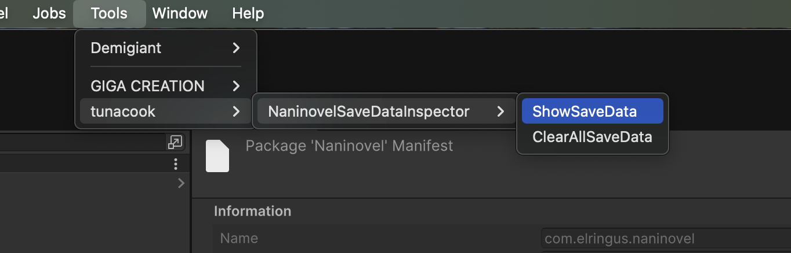
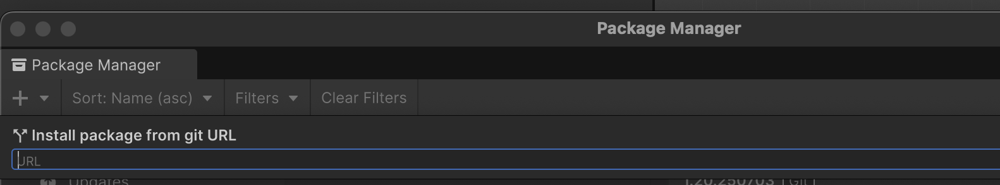
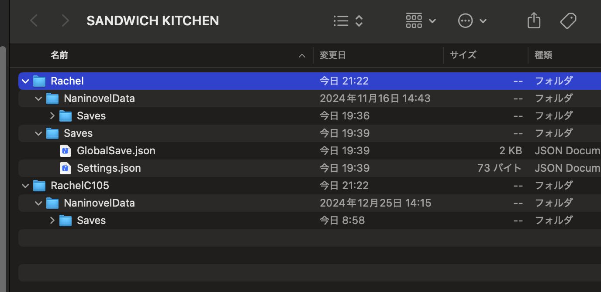

# NaninovelSaveDataInspector

Naninovelでビルドしたセーブデータが格納されている場所にすぐアクセスしたり、消したりするためのUnityEditor拡張。

## Usage
Window->`Package Manager`->`Install package from git URL` で開く

`git+ssh://git@github.com/tunacook/NaninovelSaveDataInspector.git` を指定

-----

## Features

### ShowSaveData

Finderでビルドごとのセーブデータが入っている場所を開く

つまりUnityの[Application.persistentDataPath](https://docs.unity3d.com/ja/2020.2/ScriptReference/Application-persistentDataPath.html)

### ClearAllSaveData

ShowSaveDataにあるディレクトリを全て削除する

### ShowEditorSaveData

UnityEditorでのセーブデータが入っている場所をFinderで開く

### ShowCurrentProductPlayerLog

ビルドのPlayerログが入っている場所をFinderで開く

### ShowPlayerLogDirectory

ビルドのPlayerログが入っている場所の一つ上のディレクトリをFinderで開く

### ShowApplicationSupportSaveData

macOS で `~/Library/Application Support` 以下にある Naninovel のセーブデータ（`Saves` ディレクトリ）をFinderで開く（macOS 以外のエディタではメニューに表示されない）

セーブデータは applicationIdentifier（Bundle Identifier）ごとのディレクトリに作られる。以下の順に探索し、最初に見つかった場所を開く（見つからない場合は探索した場所をConsoleに出力）

1. `~/Library/Application Support/(applicationIdentifier)/NaninovelData/Saves`
2. `~/Library/Application Support/(applicationIdentifier)/Saves`
